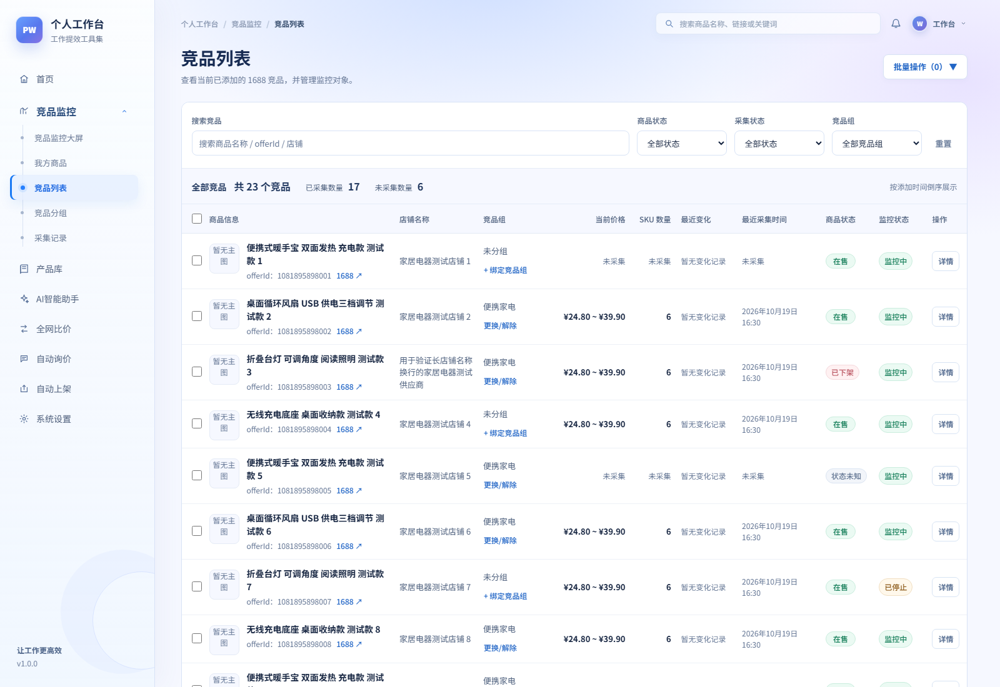
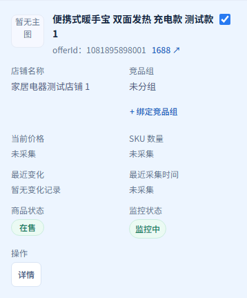

# 竞品列表视觉 V1.2 验证

日期：2026-10-20。截图为真实 Chromium 渲染的本地业务页面，采用同一组 **23 条受控测试数据**，非正式库或 1688 实采。前后使用 1600×1100 桌面和 390×844 窄屏视口。桌面应用内部纵向滚动，截图保留首屏；窄屏截图为完整页面。

## 前后对照

| 场景 | 改版前 | 改版后 |
| --- | --- | --- |
| 桌面 | [原图](before-desktop.png) | [原图](after-desktop.png) |
| 选择与批量菜单 | [原图](before-selected-menu.png) | [原图](after-selected-menu.png) |
| 窄屏 | [原图](before-narrow.png) | [原图](after-narrow.png) |
| 搜索无结果 | [原图](before-empty.png) | [原图](after-empty.png) |

改版后桌面：

窄屏单条完整记录（同一张表格，全部字段与操作保留）：

其他状态：[加载中](after-loading.png)、[加载失败](after-error.png)、[系统空列表](after-system-empty.png)。菜单截图在入场动画完成后获取。

## 设计与实现

- **字体**：保留 Noto Sans SC / Microsoft YaHei / sans-serif；标题固定 28px，商品 14px，正文 13px，辅助文字和 Badge 12px；等宽数字、金额右对齐，拉开真实业务事实与辅助信息的层次。没有下载字体。
- **布局**：筛选、统计、数据、分页合为单一连续工作区；合并重复的全部竞品标题与数量；窄屏重排同一语义表格，完整保留选择、分组、价格、SKU、变化、时间、两种状态和详情。
- **组件**：复用现有原生控件、Badge、ProductImage、分页、批量菜单；实白表面取消重复毛玻璃与阴影，选择行有明确背景，标签/焦点/禁用态清晰。外链文字压缩为 1688 ↗，保留完整 accessible name 和原链接。
- **动效**：菜单 160ms opacity + 4px 位移；控件和行反馈 120ms；仅精确指针 Hover；减少动态效果关闭动画与过渡。不做表格 stagger、数值跳动或页面转场。

两个候选方向与最小规范例外见 [局部 Spec](../../specs/competitor-list-visual-v1.2.md)。这是本轮授权的局部 POC Spec Review，不声称正式 ChatGPT GitHub Freeze。

## 验证记录

- `npm run build`：PASS（含 TypeScript）；`npm test`：221/221 PASS。
- 首轮列表分页、身份/入口、分组目录、导航及视觉 E2E：24/24 PASS。
- 合并标题/元数据后的列表与视觉回归：9/9 PASS；补充状态、多宽度、键盘和 reduced-motion 检查：2/2 PASS。
- 最终视觉/状态/触屏模拟检查：3/3 PASS，触屏上下文验证粗指针媒体条件与分页/批量按钮计算样式；读取样式前等待响应式过渡到达终态。
- 320、390、768、1024、1280px 无页面横向溢出；窄屏详情可滚动到达；我方商品不匹配 competitor 作用域。
- 初始单测发现原“无可见搜索标签”断言与新布局冲突，已针对明确新增标签更新；其余业务断言保留。
- Code Review / Final Gate 初审发现旧全局 Hover 对粗指针仍生效，已补齐局部覆盖；菜单截图曾处于动画中间帧，已等待动画结束重拍。独立只读复审关闭两项，Standards/Spec PASS，P0–P3=0。
- 与实施前保存的 tracked diff 逐项比较，除授权的 App.tsx 与 ui-system.md 外，所有原 dirty 差异保持一致；App.css 与实施前字节完全相同。新增 App.test.tsx 差异仅一项搜索标签测试；资料库与后端业务代码没有本轮改动。

## 交付范围与限制

代码：`frontend/src/App.tsx` 展示结构，新增 `frontend/src/CompetitorList.css`，`frontend/src/App.test.tsx` 标签断言，新增 `frontend/e2e/competitor-visual.spec.ts`。规范仅追加竞品页局部例外，没有改写历史合同、安装 Skill 或新增依赖。

未 Commit/Push，未访问正式数据库或真实 1688，未验证实机触屏/屏幕阅读器/其他浏览器。窄屏沿用原应用导航能力，本轮只处理进入竞品页后的布局，不建设全局移动导航。最终视觉偏好仍由用户人工验收。
