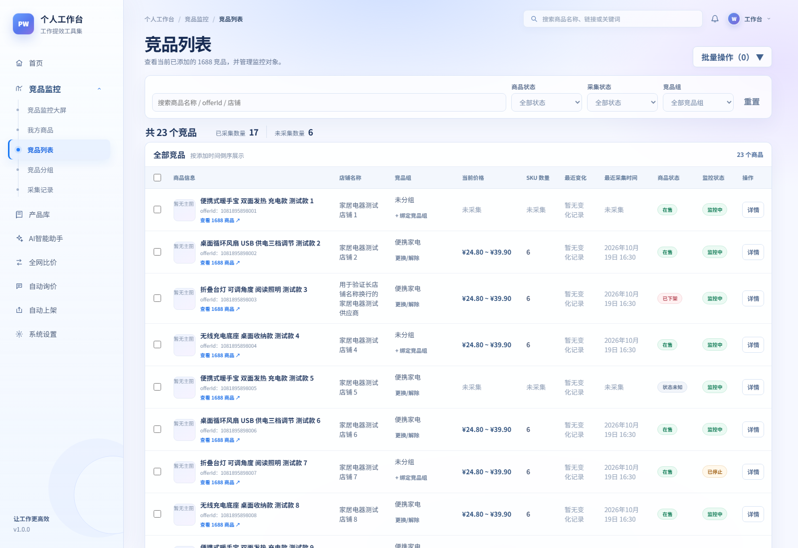
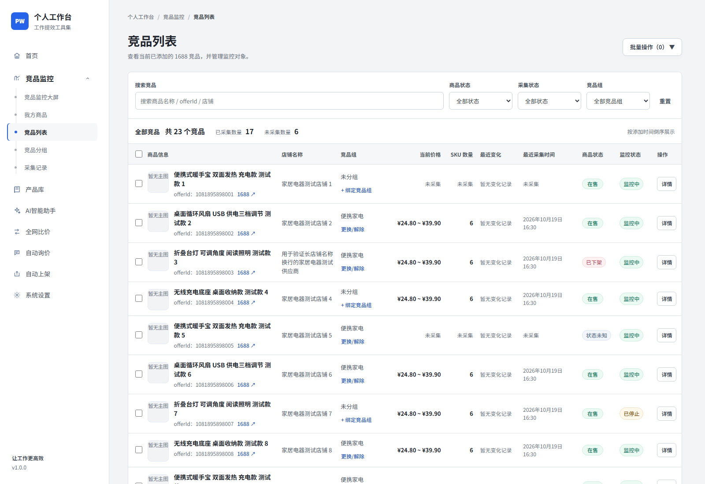
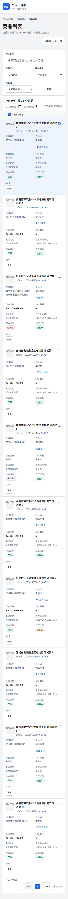
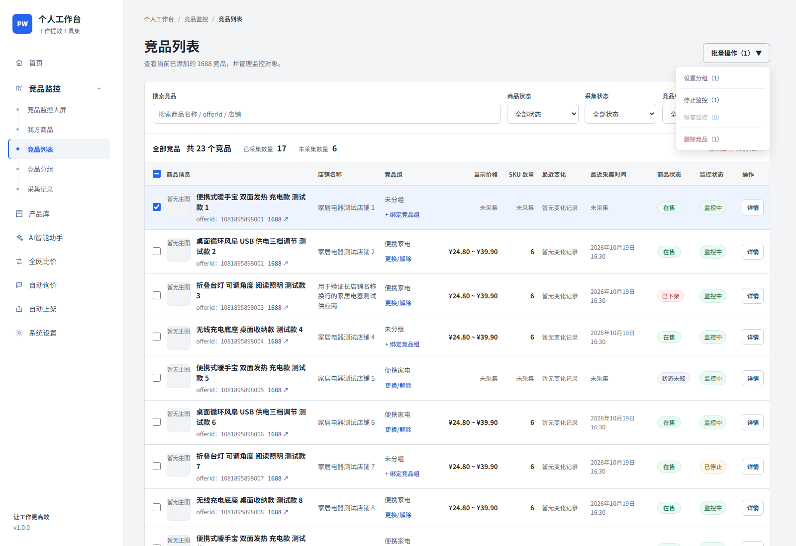

# 竞品列表视觉 V1.3 验证

截图由真实 Chromium 浏览器渲染。前后采用同一套 23 条受控测试竞品、同一组筛选/选择状态和相同视口；没有访问正式数据库或 1688。桌面视口为 1600×1100，窄屏视口为 390×844（窄屏页面截图完整记录列表）。

## 前后截图

| 场景 | 改版前 | 改版后 |
| --- | --- | --- |
| 桌面列表 | [改版前](before-desktop.png) | [改版后](after-desktop.png) |
| 选择与批量菜单 | [改版前](before-selected-menu.png) | [改版后](after-selected-menu.png) |
| 窄屏列表 | [改版前](before-narrow.png) | [改版后](after-narrow.png) |
| 搜索无结果 | [改版前](before-empty.png) | [改版后](after-empty.png) |

### 桌面

改版前：

改版后：

### 窄屏和交互状态

其他状态：[加载中](after-loading.png)、[加载错误](after-error.png)、[系统空列表](after-system-empty.png)。

## 视觉 Review

- 中性灰画布、白色工作区和侧栏替代蓝紫背景与侧栏光晕；品牌标记和选中态使用纯色蓝；移除了无行为的搜索、通知和账户占位装饰。
- 竞品标题、数字与辅助信息有明确深浅/字号层级；状态标签保留文字和语义色，数字按列排齐。
- V1.2 的筛选、统计、表格、分页结构未变；桌面列与窄屏表格字段、选择及操作均保留。
- 工作区以灰阶表头和行分隔建立层级，筛选控件、按钮和分页使用一致的小圆角、边线与焦点态。
- App Shell 的背景、侧栏和导航外观全局改变；Dashboard、详情、分组、资料库和设置内部组件尚未逐页迁移。

## 验证

- 前端单测：221/221 通过。
- 生产构建（TypeScript + Vite）：通过。
- Chromium E2E：19/19 通过，覆盖视觉状态、触屏 hover、分页跨页选择、批量操作、竞品分组目录和侧边栏导航。
- 视觉 E2E 检查 320、390、768、1024、1280、1600px 页面宽度，无横向溢出；同时检查键盘焦点与 reduced-motion 菜单状态。
- `git diff --check`：通过；仅有既有文件的 CRLF 转换提示。

Standards / Spec Final Gate：通过，无当前 findings。本轮未运行后端测试；没有修改业务接口或数据库。不 Commit/Push。
